# [O Sumiço de URF]

## Sobre este projeto:
Este repositório corresponde a um projeto que busca simular um RPG de mesa e foi desenvolvido durante a disciplina 'Programação' do curso de Bacharelado em Sistemas de Informação (CERES/UFRN)

**Aluno:** Rafael Felipe de Araújo  
**Matrícula:** 20260014088

## História

    Seria exagero falar que Runeterra estava num estado de paz e harmonia quando tudo isso aconteceu, mas a verdade é que nenhum dos conflitos ou questões que pudessem estar ocorrendo em qualquer região desse mundo que fosse poderia se comparar à calamidade que estaria por vir.

    Acontece que todo esse mundo repleto de magia e criaturas poderosas era regido por uma figura divina muito especial: <b><i>o URF!</i></b>

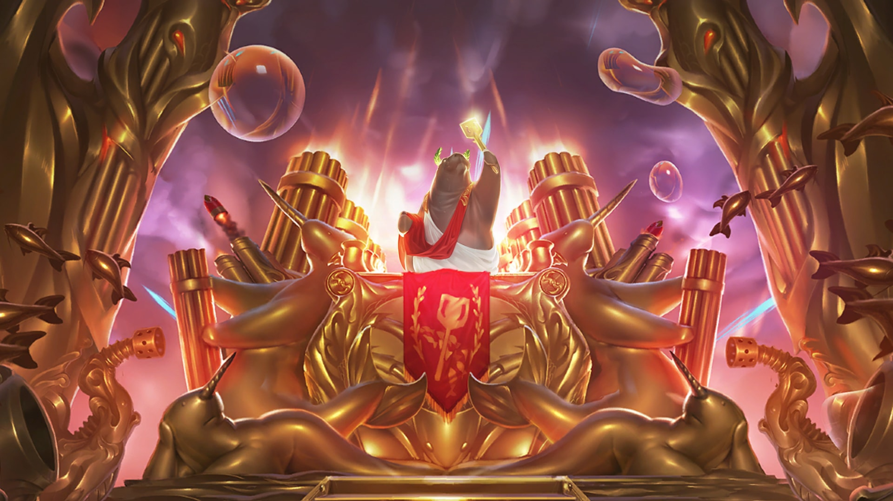

    Com a sua lendária <b>Espátula Dourada</b>, Urf era responsável por manter a ordem em Runeterra. Mais forte que qualquer entidade cósmica, aspecto targonês ou demônio primordial, esse peixe-boi divino era o significado de poder supremo!

    Até que um dia ele simplesmente sumiu!

    Quem descobriu isso foi o <b><i>Ryze, O Mago Rúnico de Runeterra.</i></b>

    Vagando pelo mundo há muito, muito (muitíssimo!) tempo mesmo, ele sempre estava alerta em relação a qualquer evento que pudesse por Runeterra em perigo - algo normal depois de viver por tantas e tantas eras.

    Dessa forma, ao descobrir que a divindade suprema havia desaparecido, Ryze decidiu partir em busca de indivíduos que pudessem ajudar a encontrar o deus peixe-boi supremo e restaurar a ordem no mundo.

    Com isso, analisando os possíveis perigos que poderiam estar a sua frente, ele escolheu os seus aliados.

    <b><i>Kai'sa, A Filha do Vazio.</i></b>

    Levada para o Vazio ainda quando era apenas uma garotinha, quando sua vila foi atacada pelos monstros do Vazio, Kai'sa mudou completamente nesse mundo selvagem. Lá, era matar ou morrer!

    Foi assim que ela se tornou a primeira humana a entrar no Vazio e retornar com vida...

    Ora, estamos falando do sumiço da divindade suprema.

    Ryze não tinha uma ideia exata do que poderia enfrentar, mas sabia que numa situação como essa certamente o Vazio estaria envolvido, e ter ao seu lado a única pessoa que conseguiu sobreviver a essa dimensão misteriosa (e extremamente perigosa) parecia ser uma boa ideia.

    E ele também foi recorrer a ajuda de outro ser bastante inusitado...

    <b><i>Volibear, A Tempestade Implacável.</i></b>

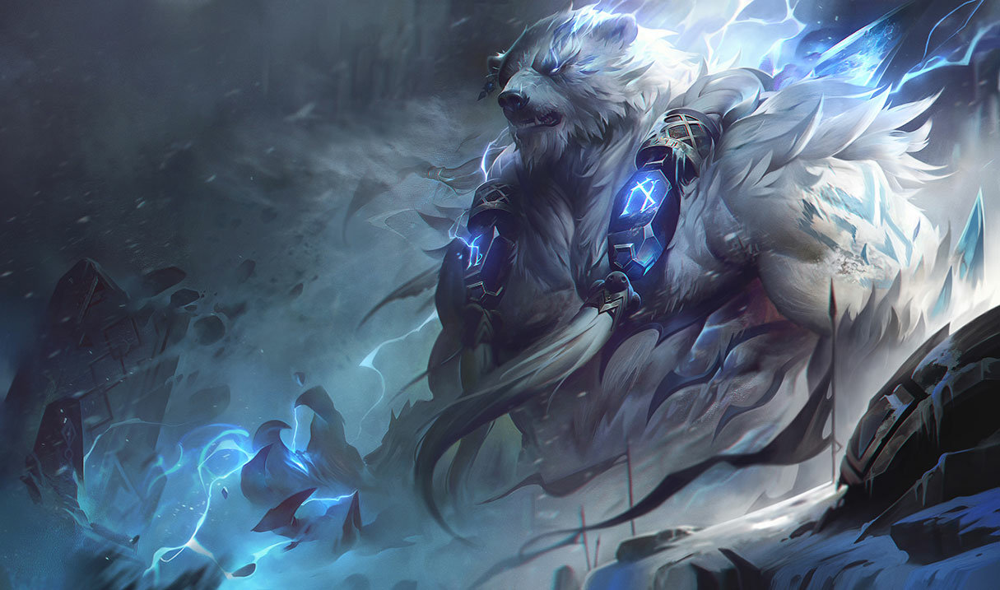

    Volibear é um dos antigos semideuses de Freljord. Irmão de Ornn, semideus freljordano da forja e artesanato, e Anivia, semideusa freljordana do inverno e da vida.

    Tendo travado várias batalhas ao lado dos seus irmãos semideuses, Volibear viu a humanidade abandonar os antigos costumes e decidiu se rebelar.

    Nos dias atuais, este antigo semideus freljordano da tempestade é a encarnação da selvageria. Apesar disso, Ryze achou que um semideus poderia ser de grande ajuda na busca por um deus.

    E assim, o destino de Runeterra estava nas mãos deste trio improvável...

## Galeria de Personagens (Heróis)

    <b><i>Ryze, O Mago Rúnico.</i></b>

  

| Classe                | Habilidade Especial | Vida  | Dano de Ataque  | Poder de Habilidade | Armadura  | Resistência Mágica  |
|-----------------------|---------------------|-------|-----------------|---------------------|-----------|---------------------|
| Mago                  | Fluxo de Feitiço    | 620   | 55              | 110                 | 22        | 32                  |

    <b>Descrição de Personagem:</b> Ryze é um campeão Mago, focado em Dano Mágico. Utilizar sua Habilidade Especial sempre será a forma mais eficaz de batalhar com ele.

    <b>Descrição de Habilidade Especial:</b> Ryze lança uma onda de energia capaz de causar dano a todos os inimigos ao redor.

 

    <b><i>Kai'sa, A Filha do Vazio.</i></b>

  

| Classe                                  | Habilidade Especial     | Vida  | Dano de Ataque  | Poder de Habilidade | Armadura  | Resistência Mágica  |
|-----------------------------------------|-------------------------|-------|-----------------|---------------------|-----------|---------------------| 
| Atirador de Dano Físico                 | Exploradora do Vazio    | 640   | 59              | 100                 | 25        | 33                  |

    <b>Descrição de Personagem:</b> Kai'sa é uma atiradora de Dano Físico. Nas batalhas, usar Ataque Básico sempre será a forma mais prática de derrotar os seus inimigos.

    <b>Descrição de Habilidade Especial:</b> Kai'sa lança projétil a um inimigo de sua escolha.

 

    <b><i>Volibear, A Tempestade Implacável.</i></b>

  

| Classe                | Habilidade Especial         | Vida  | Dano de Ataque  | Poder de Habilidade | Armadura  | Resistência Mágica  |
|-----------------------|-----------------------------|-------|-----------------|---------------------|-----------|---------------------| 
| Tanque                | Emissário da Tempestade     | 650   | 65              | 90                  | 35        | 32                  |

    <b>Descrição de Personagem:</b> A principal característica de Volibear é a sua resistência, podendo virar um verdadeiro colosso no campo de batalha.

    <b>Descrição de Habilidade Especial:</b> Volibear causa uma pequena quantidade de Dano Mágico aos inimigos ao redor e aumenta consideravelmente sua Vida, Armadura e Resistência Mágica pelos próximos 2 turnos.

 

## Galeria de Monstros e Vilões

    <b><i>Espiã da Rosa Negra</i> [Monstro]</b>

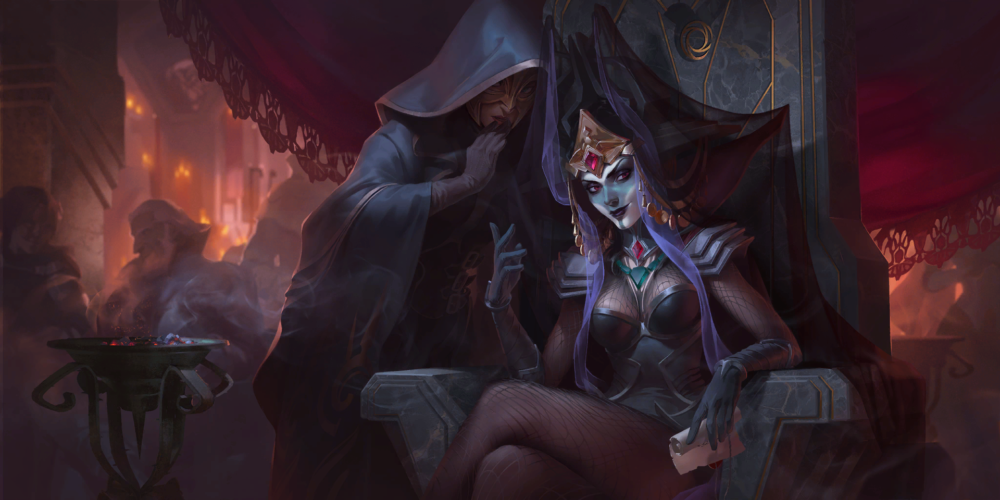
  

| Classe                | Habilidade Especial | Vida  | Dano de Ataque  | Poder de Habilidade  | Armadura  | Resistência Mágica  |
|-----------------------|---------------------|-------|-----------------|----------------------|-----------|---------------------|
| Mago                  | Reputação           | 420   | 35              | 1000                 | 22        | 32                  |

    <b>Descrição de Personagem:</b> Serva leal de LeBlanc. Existem várias iguais a ela espalhada por Runeterra.

    <b>Descrição de Habilidade Especial:</b> Habilidade passiva sem efeito em combate. Ao morrer, desaparece e fortalece LeBlanc, aumentando os atributos desta.

 

    <b><i>LeBlanc, A Farsante</i> [Vilão]</b>

  

| Classe                | Habilidade Especial | Vida  | Dano de Ataque  | Poder de Habilidade | Armadura  | Resistência Mágica  |
|-----------------------|---------------------|-------|-----------------|---------------------|-----------|---------------------|
| Mago                  | Distorção           | 620   | 55              | 110                 | 22        | 32                  |

    <b>Descrição de Personagem:</b> Líder da organização secreta mundial conhecida como Rosa Negra. LeBlanc já esteve por trás dos mais diversos conflitos, nas mais diversas regiões de Runeterra. (Na verdade, LeBlanc é um demônio.)

    <b>Descrição de Habilidade Especial:</b> LeBlanc avança até o inimigo, causando dano a ele. A habilidade sempre será mais forte na próxima vez que for usada.

 

    <b><i>Espectros Agrilhoados</i> [Monstro]</b>

  

| Classe                | Habilidade Especial | Vida   | Dano de Ataque  | Poder de Habilidade | Armadura  | Resistência Mágica  |
|-----------------------|---------------------|--------|-----------------|---------------------|-----------|---------------------|
| Mago                  | Último Suspiro      | 1200   | 55              | 100                 | 10        | 05                  |

    <b>Descrição de Personagem:</b> Legião de servos espectrais do Mordekaiser.

    <b>Descrição de Habilidade Especial:</b> Lança uma maldição no inimigo. Perde uma quantidade de vida, mas inflige o equivalente no inimigo.

 

    <b><i>Mordekaiser, O Ravenã de Ferro</i> [Vilão]</b>

  

| Classe                | Habilidade Especial | Vida   | Dano de Ataque  | Poder de Habilidade | Armadura  | Resistência Mágica  |
|-----------------------|---------------------|--------|-----------------|---------------------|-----------|---------------------|
| Mago                  | Reino da Morte      | 1100   | 60              | 100                 | 35        | 30                  |

    <b>Descrição de Personagem:</b> Um senhor da guerra cruel. Acreditava que quando morresse iria para o Salão dos Ossos, o lar das almas de grandes guerreiros. No pós-vida, se deparou com um monte de nada. Sua ira foi tão grande que sua alma conseguiu voltar ao mundo dos vivos.

    <b>Descrição de Habilidade Especial:</b> Mordekaiser leva o inimigo para o seu próprio reino sombrio. Mordekaiser se fortalece, recebendo parte dos atributos do inimigo, além de causar dano periodicamente.

 

    <b><i>Tenor do Terror</i> [Monstro]</b>

  

| Classe                | Habilidade Especial | Vida  | Dano de Ataque  | Poder de Habilidade | Armadura  | Resistência Mágica  |
|-----------------------|---------------------|-------|-----------------|---------------------|-----------|---------------------|
| Mago                  | Magia Impactante    | 500   | 55              | 120                 | 20        | 20                  |

    <b>Descrição de Personagem:</b> Ajudante (extremamente competente) de Veigar.

    <b>Descrição de Habilidade Especial:</b> Lança uma rajada de energia no inimigo.

 

    <b><i>Veigar, O Pequeno Mestre do Mal</i> [Vilão]</b>

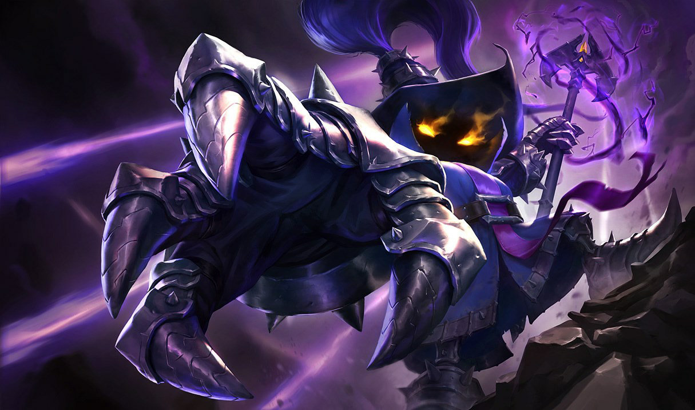
  

| Classe                | Habilidade Especial    | Vida  | Dano de Ataque  | Poder de Habilidade | Armadura  | Resistência Mágica  |
|-----------------------|------------------------|-------|-----------------|---------------------|-----------|---------------------|
| Mago                  | Explosão Primordial    | 630   | 50              | 100                 | 40        | 40                  |

    <b>Descrição de Personagem:</b> Já foi um escravo nas mãos de Mordekaiser. Agora que está livre, quer mostrar para todo o mundo que é o Verdadeiro Senhor Supremo do Mal! (O tempo em que passou sendo escravo de Mordekaiser obviamente não lhe fez bem.)

    <b>Descrição de Habilidade Especial:</b> Atinge o alvo com uma imensa rajada de energia e malvadeza!

 

## Galeria de Itens

    <b><i>Anel de Doran</i> [Item Inicial]</b>

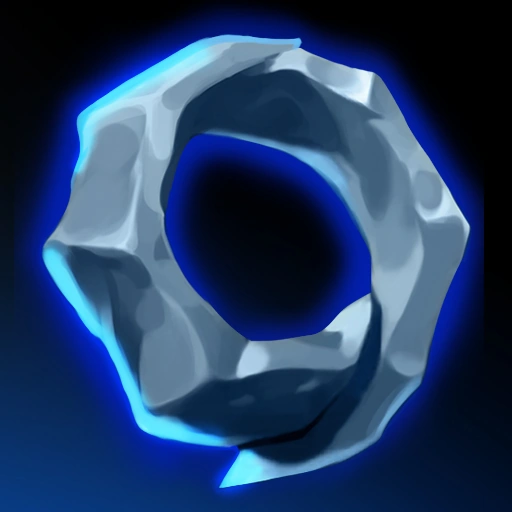
  

    <b>Descrição do Item:</b> Aumenta levemente o Poder de Habilidade do usuário.

 

    <b><i>Lâmina de Doran</i> [Item Inicial]</b>

  

    <b>Descrição do Item:</b> Aumenta levemente o Dano de Ataque do usuário.

 

    <b><i>Escudo de Doran</i> [Item Inicial]</b>

  

    <b>Descrição do Item:</b> Aumenta levemente a Armadura e a Resistência Mágica do usuário.

 

    <b><i>Bastão Desnecessariamente Grande</i> [Item Intermediário]</b>

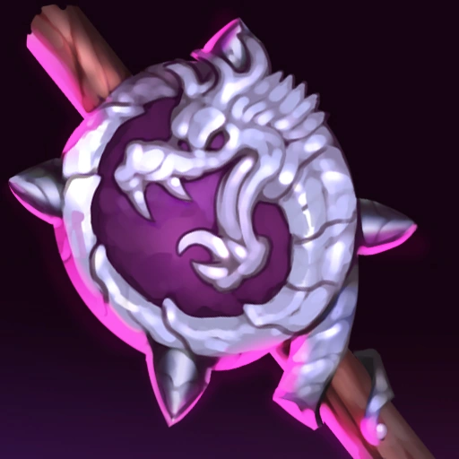
  

    <b>Descrição do Item:</b> Aumenta consideravelmente o Poder de Habilidade do usuário.

 

    <b><i>Espada G.p.C.</i> [Item Intermediário]</b>

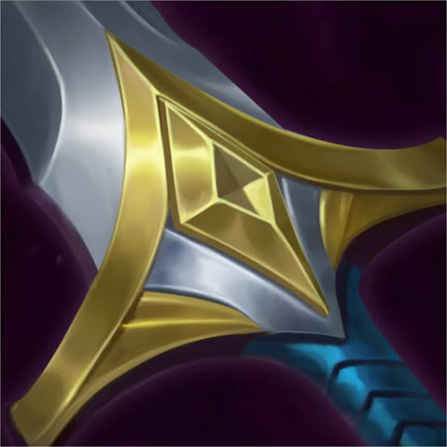
  

    <b>Descrição do Item:</b> Aumenta consideravelmente o Dano de Ataque do usuário.

 

    <b><i>Passos de Mercúrio</i> [Item Intermediário]</b>

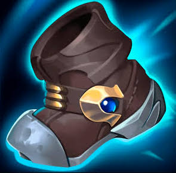
  

    <b>Descrição do Item:</b> Aumenta consideravelmente a Armadura e a Resistência Mágica do usuário.

 

    <b><i>Capuz da Morte de Rabadon</i> [Item Lendário]</b>

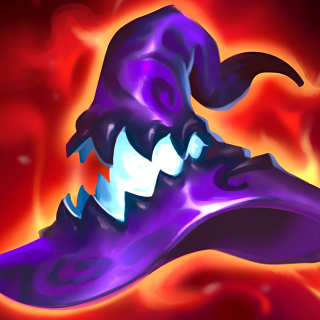
  

    <b>Descrição do Item:</b> Aumenta exponencialmente o Poder de Habilidade do usuário.

 

    <b><i>Gume do Infinito</i> [Item Lendário]</b>

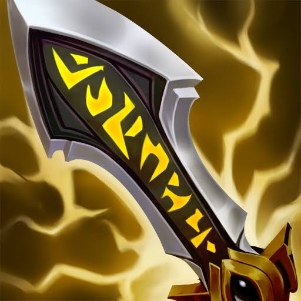
  

    <b>Descrição do Item:</b> Aumenta exponencialmente o Dano de Ataque do usuário.

 

    <b><i>Jak'Sho, O Inconstante</i> [Item Lendário]</b>

  

    <b>Descrição do Item:</b> Aumenta exponencialmente a Armadura e a Resistência Mágica do usuário.

 

    <b><i>Anjo Guardião</i> [Item Épico]</b>

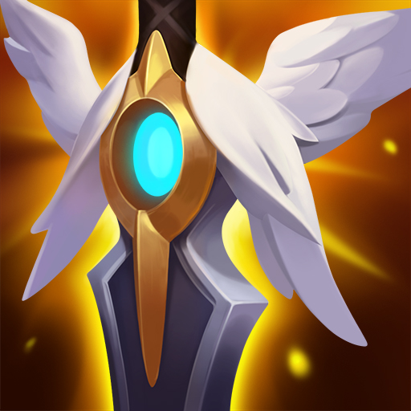
  

    <b>Descrição do Item:</b> Concede uma vida a mais ao usuário!

 

## Como compilar e jogar
1. Instale o gcc ('sudo apt install build-essential')
2. Compile: 'gcc -Wall -Wextra -o jogo src/main.c -lm'
3. Execute: './jogo'

## Vídeo de Demonstração
Assista no XXX: link