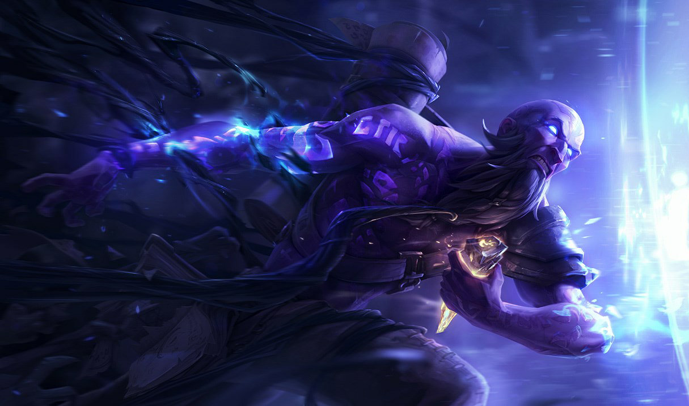
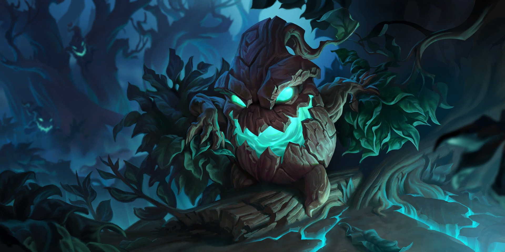
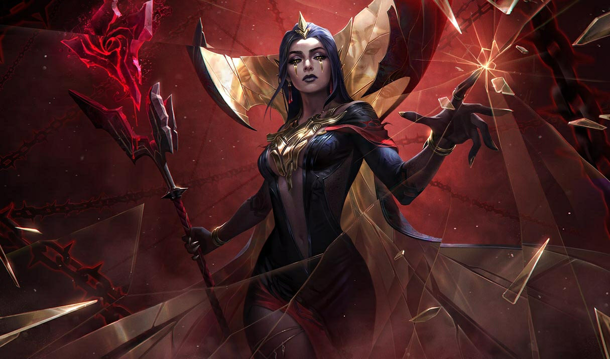
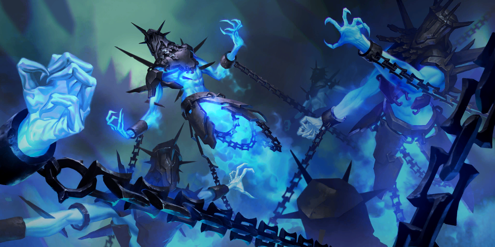
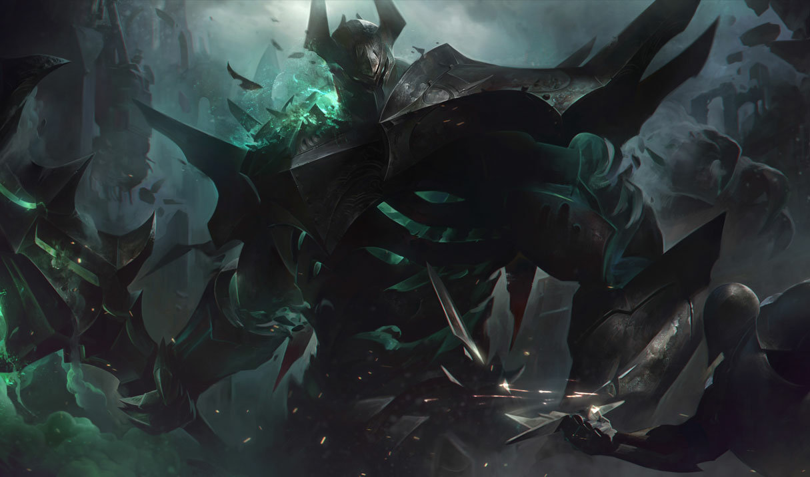
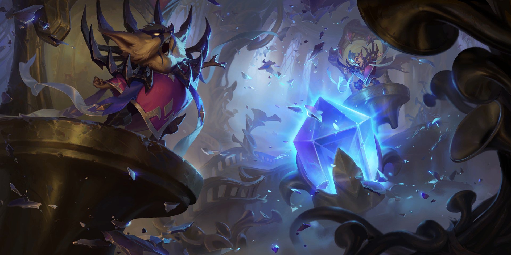
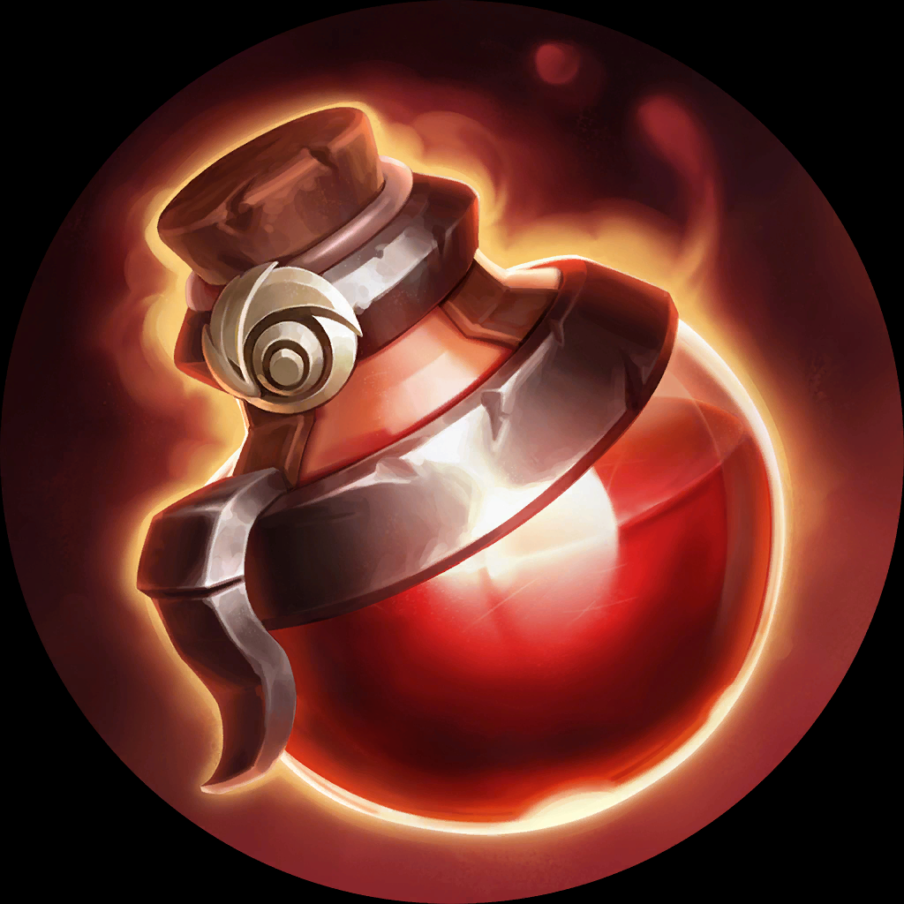
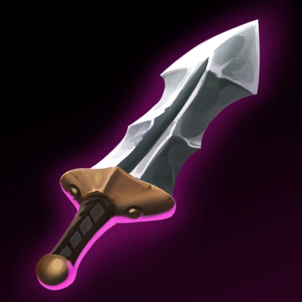
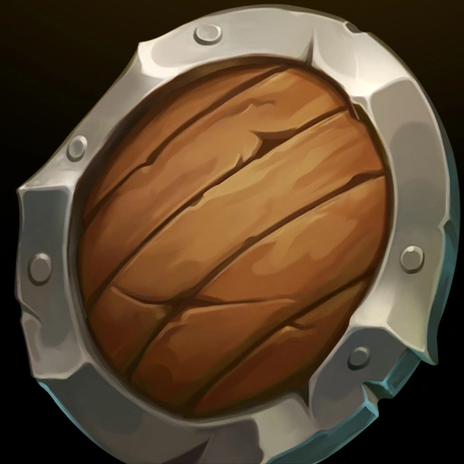

# [O Sumiço de URF]

## Sobre este projeto:
Este repositório corresponde a um projeto que busca simular um RPG de mesa e foi desenvolvido durante a disciplina 'Programação' do curso de Bacharelado em Sistemas de Informação (CERES/UFRN)

**Aluno:** Rafael Felipe de Araújo  
**Matrícula:** 20260014088

## História
<p style="text-align: justify">
    Seria exagero falar que Runeterra estava num estado de paz e harmonia quando tudo isso aconteceu, mas a verdade é que nenhum dos conflitos ou questões que pudessem estar ocorrendo em qualquer região desse mundo que fosse poderia se comparar à calamidade que estaria por vir.
</p>
<p style="text-align: justify">
    Acontece que todo esse mundo repleto de magia e criaturas poderosas era regido por uma figura divina muito especial: <b><i>o URF!</i></b>
</p>

<p style="text-align: justify">
    Com a sua lendária <b>Espátula Dourada</b>, Urf era responsável por manter a ordem em Runeterra. Mais forte que qualquer entidade cósmica, aspecto targonês ou demônio primordial, esse peixe-boi divino era o significado de poder supremo!
</p>
<p style="text-align: justify">
    Até que um dia ele simplesmente sumiu!
</p>
<p style="text-align: justify">
    Quem descobriu isso foi o <b><i>Ryze, O Mago Rúnico de Runeterra.</i></b>
</p>

<p style="text-align: justify">
    Vagando pelo mundo há muito, muito (muitíssimo!) tempo mesmo, ele sempre estava alerta em relação a qualquer evento que pudesse por Runeterra em perigo - algo normal depois de viver por tantas e tantas eras.
</p>
<p style="text-align: justify">
    Dessa forma, ao descobrir que a divindade suprema havia desaparecido, Ryze decidiu partir em busca de indivíduos que pudessem ajudar a encontrar o deus peixe-boi supremo e restaurar a ordem no mundo.
</p>
<p style="text-align: justify">
    Com isso, analisando os possíveis perigos que poderiam estar a sua frente, ele escolheu os seus aliados.
</p>
<p style="text-align: justify">
    <b><i>Kai'sa, A Filha do Vazio.</i></b>
</p>

<p style="text-align: justify">
    Levada para o Vazio ainda quando era apenas uma garotinha, quando sua vila foi atacada pelos monstros do Vazio, Kai'sa mudou completamente nesse mundo selvagem. Lá, era matar ou morrer!
</p>
<p style="text-align: justify">
    Foi assim que ela se tornou a primeira humana a entrar no Vazio e retornar com vida...
</p>
<p style="text-align: justify">
    Ora, estamos falando do sumiço da divindade suprema.
</p>
<p style="text-align: justify">
    Ryze não tinha uma ideia exata do que poderia enfrentar, mas sabia que numa situação como essa certamente o Vazio estaria envolvido, e ter ao seu lado a única pessoa que conseguiu sobreviver a essa dimensão misteriosa (e extremamente perigosa) parecia ser uma boa ideia.
</p>
<p style="text-align: justify">
    E ele também foi recorrer a ajuda de outro ser bastante inusitado...
</p>
<p style="text-align: justify">
    <b><i>Volibear, A Tempestade Implacável.</i></b>
</p>

<p style="text-align: justify">
    Volibear é um dos antigos semideuses de Freljord. Irmão de Ornn, semideus freljordano da forja e artesanato, e Anivia, semideusa freljordana do inverno e da vida.
</p>
<p style="text-align: justify">
    Tendo travado várias batalhas ao lado dos seus irmãos semideuses, Volibear viu a humanidade abandonar os antigos costumes e decidiu se rebelar.
</p>
<p style="text-align: justify">
    Nos dias atuais, este antigo semideus freljordano da tempestade é a encarnação da selvageria. Apesar disso, Ryze achou que um semideus poderia ser de grande ajuda na busca por um deus.
</p>
<p style="text-align: justify">
    E assim, o destino de Runeterra estava nas mãos deste trio improvável...
</p>

## Galeria de Campeões (Heróis)

<p style="text-align: justify">
    <b><i>Ryze, O Mago Rúnico.</i></b>
</p>

<br><br>

| Classe                | Habilidade Especial | Vida  | Dano de Ataque  | Poder de Habilidade | Armadura  | Resistência Mágica  |
|-----------------------|---------------------|-------|-----------------|---------------------|-----------|---------------------|
| Mago                  | Fluxo de Feitiço    | 620   | 55              | 110                 | 22        | 32                  |

<p style="text-align: justify">
    <b>Descrição de Personagem:</b> Ryze é um campeão Mago, focado em Dano Mágico. Utilizar sua Habilidade Especial sempre será a forma mais eficaz de batalhar com ele.
</p>
<p style="text-align: justify">
    <b>Descrição de Habilidade Especial:</b> Ryze lança uma onda de energia capaz de causar dano a todos os inimigos ao redor.
</p>
<br>

<p style="text-align: justify">
    <b><i>Kai'sa, A Filha do Vazio.</i></b>
</p>

<br><br>

| Classe                                  | Habilidade Especial     | Vida  | Dano de Ataque  | Poder de Habilidade | Armadura  | Resistência Mágica  |
|-----------------------------------------|-------------------------|-------|-----------------|---------------------|-----------|---------------------| 
| Atirador de Dano Físico                 | Exploradora do Vazio    | 640   | 59              | 100                 | 25        | 33                  |

<p style="text-align: justify">
    <b>Descrição de Personagem:</b> Kai'sa é uma atiradora de Dano Físico. Nas batalhas, usar Ataque Básico sempre será a forma mais prática de derrotar os seus inimigos.
</p>
<p style="text-align: justify">
    <b>Descrição de Habilidade Especial:</b> Kai'sa lança projétil a um inimigo de sua escolha.
</p>
<br>

<p style="text-align: justify">
    <b><i>Volibear, A Tempestade Implacável.</i></b>
</p>

<br><br>

| Classe                | Habilidade Especial         | Vida  | Dano de Ataque  | Poder de Habilidade | Armadura  | Resistência Mágica  |
|-----------------------|-----------------------------|-------|-----------------|---------------------|-----------|---------------------| 
| Tanque                | Emissário da Tempestade     | 650   | 65              | 90                  | 35        | 32                  |

<p style="text-align: justify">
    <b>Descrição de Personagem:</b> A principal característica de Volibear é a sua resistência, podendo virar um verdadeiro colosso no campo de batalha.
</p>
<p style="text-align: justify">
    <b>Descrição de Habilidade Especial:</b> Volibear causa uma pequena quantidade de Dano Mágico aos inimigos ao redor e aumenta consideravelmente sua Vida, Armadura e Resistência Mágica pelos próximos 2 turnos.
</p>
<br>

## Galeria de Armadilha, Monstros e Chefões

<p style="text-align: justify">
    <b><i>Muda</i> [Armadilha]</b>
</p>

<br><br>

<p style="text-align: justify">
    <b>Descrição de Personagem:</b> Estas plantinhas irritantes estão por toda parte. Um encontro com elas significa perder um pouco de vida.
</p>
<br>

<p style="text-align: justify">
    <b><i>Espiã da Rosa Negra</i> [Monstro]</b>
</p>

<br><br>

| Classe                | Habilidade Especial | Vida  | Dano de Ataque  | Poder de Habilidade  | Armadura  | Resistência Mágica  |
|-----------------------|---------------------|-------|-----------------|----------------------|-----------|---------------------|
| Mago                  | Reputação           | 420   | 35              | 1000                 | 22        | 32                  |

<p style="text-align: justify">
    <b>Descrição de Personagem:</b> Serva leal de LeBlanc. Existem várias iguais a ela espalhada por Runeterra.
</p>
<p style="text-align: justify">
    <b>Descrição de Habilidade Especial:</b> Habilidade passiva sem efeito em combate. Ao morrer, desaparece e fortalece LeBlanc, aumentando os atributos desta.
</p>
<br>

<p style="text-align: justify">
    <b><i>LeBlanc, A Farsante</i> [Chefão]</b>
</p>

<br><br>

| Classe                | Habilidade Especial | Vida  | Dano de Ataque  | Poder de Habilidade | Armadura  | Resistência Mágica  |
|-----------------------|---------------------|-------|-----------------|---------------------|-----------|---------------------|
| Mago                  | Distorção           | 620   | 55              | 110                 | 22        | 32                  |

<p style="text-align: justify">
    <b>Descrição de Personagem:</b> Líder da organização secreta mundial conhecida como Rosa Negra. LeBlanc já esteve por trás dos mais diversos conflitos, nas mais diversas regiões de Runeterra. (Na verdade, LeBlanc é um demônio.)
</p>
<p style="text-align: justify">
    <b>Descrição de Habilidade Especial:</b> LeBlanc avança até o inimigo, causando dano a ele. A habilidade sempre será mais forte na próxima vez que for usada.
</p>
<br>

<p style="text-align: justify">
    <b><i>Espectros Agrilhoados</i> [Monstro]</b>
</p>

<br><br>

| Classe                | Habilidade Especial | Vida   | Dano de Ataque  | Poder de Habilidade | Armadura  | Resistência Mágica  |
|-----------------------|---------------------|--------|-----------------|---------------------|-----------|---------------------|
| Mago                  | Último Suspiro      | 1200   | 55              | 100                 | 10        | 05                  |

<p style="text-align: justify">
    <b>Descrição de Personagem:</b> Legião de servos espectrais do Mordekaiser.
</p>
<p style="text-align: justify">
    <b>Descrição de Habilidade Especial:</b> Lança uma maldição no inimigo. Perde uma quantidade de vida, mas inflige o equivalente no inimigo.
</p>
<br>

<p style="text-align: justify">
    <b><i>Mordekaiser, O Ravenã de Ferro</i> [Chefão]</b>
</p>

<br><br>

| Classe                  | Habilidade Especial | Vida   | Dano de Ataque  | Poder de Habilidade | Armadura  | Resistência Mágica  |
|-------------------------|---------------------|--------|-----------------|---------------------|-----------|---------------------|
| Tanque                  | Reino da Morte      | 1100   | 60              | 100                 | 35        | 30                  |

<p style="text-align: justify">
    <b>Descrição de Personagem:</b> Um senhor da guerra cruel. Acreditava que quando morresse iria para o Salão dos Ossos, o lar das almas de grandes guerreiros. No pós-vida, se deparou com um monte de nada. Sua ira foi tão grande que sua alma conseguiu voltar ao mundo dos vivos.
</p>
<p style="text-align: justify">
    <b>Descrição de Habilidade Especial:</b> Mordekaiser leva o inimigo para o seu próprio reino sombrio. Mordekaiser se fortalece, recebendo parte dos atributos do inimigo, além de causar dano periodicamente.
</p>
<br>

<p style="text-align: justify">
    <b><i>Tenor do Terror</i> [Monstro]</b>
</p>

<br><br>

| Classe                | Habilidade Especial | Vida  | Dano de Ataque  | Poder de Habilidade | Armadura  | Resistência Mágica  |
|-----------------------|---------------------|-------|-----------------|---------------------|-----------|---------------------|
| Mago                  | Magia Impactante    | 500   | 55              | 120                 | 20        | 20                  |

<p style="text-align: justify">
    <b>Descrição de Personagem:</b> Ajudante (extremamente competente) de Veigar.
</p>
<p style="text-align: justify">
    <b>Descrição de Habilidade Especial:</b> Lança uma rajada de energia no inimigo.
</p>
<br>

<p style="text-align: justify">
    <b><i>Veigar, O Pequeno Mestre do Mal</i> [Chefão]</b>
</p>

<br><br>

| Classe                             | Habilidade Especial    | Vida  | Dano de Ataque  | Poder de Habilidade | Armadura  | Resistência Mágica  |
|------------------------------------|------------------------|-------|-----------------|---------------------|-----------|---------------------|
| SUPER MAGO DO MAL                  | Explosão Primordial    | 630   | 50              | 100                 | 40        | 40                  |

<p style="text-align: justify">
    <b>Descrição de Personagem:</b> Já foi um escravo nas mãos de Mordekaiser. Agora que está livre, quer mostrar para todo o mundo que é o Verdadeiro Senhor Supremo do Mal! (O tempo em que passou sendo escravo de Mordekaiser obviamente não lhe fez bem.)
</p>
<p style="text-align: justify">
    <b>Descrição de Habilidade Especial:</b> Atinge o alvo com uma imensa rajada de energia e malvadeza!
</p>
<br>

## Galeria de Itens

<p style="text-align: justify">
    <b><i>Poção de Vida</i> [Item de Cura]</b>
</p>

<br><br>

<p style="text-align: justify">
    <b>Descrição do Item:</b> Recupera uma quantidade razoável de vida. Pode ser encontrada andando por aqui e por ali.
</p>
<br>

<p style="text-align: justify">
    <b><i>Anel de Doran</i> [Item Inicial]</b>
</p>

<br><br>

<p style="text-align: justify">
    <b>Descrição do Item:</b> Aumenta levemente o Poder de Habilidade do usuário.
</p>
<br>

<p style="text-align: justify">
    <b><i>Lâmina de Doran</i> [Item Inicial]</b>
</p>

<br><br>

<p style="text-align: justify">
    <b>Descrição do Item:</b> Aumenta levemente o Dano de Ataque do usuário.
</p>
<br>

<p style="text-align: justify">
    <b><i>Escudo de Doran</i> [Item Inicial]</b>
</p>

<br><br>

<p style="text-align: justify">
    <b>Descrição do Item:</b> Aumenta levemente a Armadura e a Resistência Mágica do usuário.
</p>
<br>

<p style="text-align: justify">
    <b><i>Bastão Desnecessariamente Grande</i> [Item Intermediário]</b>
</p>

<br><br>

<p style="text-align: justify">
    <b>Descrição do Item:</b> Aumenta consideravelmente o Poder de Habilidade do usuário.
</p>
<br>

<p style="text-align: justify">
    <b><i>Espada G.p.C.</i> [Item Intermediário]</b>
</p>

<br><br>

<p style="text-align: justify">
    <b>Descrição do Item:</b> Aumenta consideravelmente o Dano de Ataque do usuário.
</p>
<br>

<p style="text-align: justify">
    <b><i>Passos de Mercúrio</i> [Item Intermediário]</b>
</p>

<br><br>

<p style="text-align: justify">
    <b>Descrição do Item:</b> Aumenta consideravelmente a Armadura e a Resistência Mágica do usuário.
</p>
<br>

<p style="text-align: justify">
    <b><i>Capuz da Morte de Rabadon</i> [Item Lendário]</b>
</p>

<br><br>

<p style="text-align: justify">
    <b>Descrição do Item:</b> Aumenta exponencialmente o Poder de Habilidade do usuário.
</p>
<br>

<p style="text-align: justify">
    <b><i>Gume do Infinito</i> [Item Lendário]</b>
</p>

<br><br>

<p style="text-align: justify">
    <b>Descrição do Item:</b> Aumenta exponencialmente o Dano de Ataque do usuário.
</p>
<br>

<p style="text-align: justify">
    <b><i>Jak'Sho, O Inconstante</i> [Item Lendário]</b>
</p>

<br><br>

<p style="text-align: justify">
    <b>Descrição do Item:</b> Aumenta exponencialmente a Armadura e a Resistência Mágica do usuário.
</p>
<br>

<p style="text-align: justify">
    <b><i>Anjo Guardião</i> [Item Épico]</b>
</p>

<br><br>

<p style="text-align: justify">
    <b>Descrição do Item:</b> Concede uma vida a mais ao usuário!
</p>
<br>

## Mecânica de Jogo
### Dinâmica Geral
* **Movimentação:** O Jogador lança um dado de seis lados (D6) para se mover pelo tabuleiro (matriz).  
* **Casas:** Cada casa possui um tipo (representado por enum). São eles: Vazia, Combate, Tesouro, Cura ou Chefão.
* **Combate por turnos:** Ao entrar em combate (casa Combate ou casa Chefão), o Jogador pode entre 4 ações (Atacar | Defender | Habilidade Especial | Fugir). O Jogador sempre age primeiro, depois o inimigo (Monstro ou Chefão). O combate segue até que o Jogador ou o inimigo morra, ou o Jogador realize uma fuga bem-sucedida.
* **Recompensa e evolução:** Durante a campanha, é possível evoluir o seu Campeão.
  * Ao derrotar um inimigo: Campeão recebe pontos em todos os seus atributos.
  * Ao cair numa casa Cura: o Campeão encontra uma Poção de Vida e recupera um pouco da sua vida.
  * Ao cair numa casa Tesouro: o Campeão pode escolher um Item Intermediário, capaz de aumantar Poder de Habilidade, Dano de Ataque ou Armadura e Resistência Mágica.
  * Ao derrotar LeBlanc e Mordekaiser: o Campeão pode escolher um Item Lendário, capaz de aumantar Poder de Habilidade, Dano de Ataque ou Armadura e Resistência Mágica.
  * Ao derrotar todos os Monstros e Chefões presentes no tabuleiro antes de encontrar Veigar: o Campeão recebe Anjo Guardião, que lhe concede uma vida a mais no jogo.
* **Chefão:** Cada região (fase) possui um Chefão a ser derrotado. Derrote-o para avançar para a região seguinte.
* **Fim do Jogo:** O jogo acaba quando o Jogador derrota Veigar ou se sua Vida chegar a zero. 
* **Exemplo de interação:**
  1. Jogador encontra um Inimigo.
  2. Escolhe uma ação: Atacar | Defender | Habilidade Especial | Fugir
  3. Jogador rola dado (D20).
  4. Programa calcula dano: (dado + Dano de Ataque) para Ataque Básico | (dado + Dano de Habilidade Especial + Poder de Habilidade) para Habilidade Especial
  5. Compara com a defesa do Inimigo e aplica o dano.
  6. Se o Inimigo sobreviver, ele realiza seu ataque (também com um D20).
  7. O Combate continua até que a Vida de um dos dois chegue a zero.
  8. Se o Jogador vencer, recebe a recompensa e o jogo continua.
* **Casas no Tabuleiro:**
  * **Vazia:** nada acontece.
  * **Combate:** Entra em combate com um Monstro da região (Espiã da Rosa Negra, Espectros Agrilhoados e Tenor do Terror)
  * **Tesouro:** Escolhe um Item Intermediário (Bastão Desnecessariamente Grande, Espada G.p.C., Passos de Mercúrio)
  * **Cura:** Encontra uma Poção de Vida, que restaura um pouco da Vida. A cura pode ultrapassar o limite de pontos de Vida.
  * **Chefão:** Entra em combate com o Chefão da região (LeBlanc, Mordekaiser, Veigar)


## Linguagem
C (Padrão C99)
  
## Como compilar e jogar
### No linux
1. Instale o gcc ('sudo apt install build-essential')
2. Compile: 'gcc -Wall -Wextra -o jogo src/main.c -lm'
3. Execute: './jogo'

### No Windows
1. Instale o compilador: Baixe e instale o MSYS2. Abra o terminal dele e digite (pacman -S mingw-w64-ucrt-x86_64-gcc) 
(Nota: Lembre-se de adicionar a pasta bin do MinGW nas Variáveis de Ambiente / PATH do Windows para que o comando gcc funcione no CMD ou PowerShell).
2. Compile: (gcc -Wall -Wextra -o jogo.exe src/main.c -lm)
3. Execute (jogo.exe) (no CMD) ou (.\jogo.exe) (no PowerShell)

### No macOS
1. Instale as ferramentas de compilação: Abra o Terminal e digite (xcode-select --install)
2. Compile (gcc -Wall -Wextra -o jogo src/main.c -lm)
3. Execute (./jogo)

## Sobre o código
## Principais Enums e Structs
### Campeões
```c
// Definição do tipo de Campeão
#ifndef CAMPEOES_H
#define CAMPEOES_H

typedef enum { MAGO, ATIRADOR_DE_DANO_FISICO, TANQUE, SIPER_MAGO_DO_MAL } ClasseCampeao;

typedef struct {
    char nome[20];
    ClasseCampeao classe;
    char habilidadeEspecial[40];
    int vida, vida_base;
    int tem_anjo_guardiao;
    int danoDeAtaque, poderDeHabilidade, danoHabilidadeEspecial, armadura, resistenciaMagica;
} Campeao;


Campeao criar_ryze() {
    Campeao campeao_escolhido;

    strcpy(campeao_escolhido.nome, "Ryze");
    campeao_escolhido.classe = MAGO;
    strcpy(campeao_escolhido.habilidadeEspecial, "Fluxo de Feitiço");
    campeao_escolhido.vida = 620;
    campeao_escolhido.vida_base = campeao_escolhido.vida;
    campeao_escolhido.tem_anjo_guardiao = 0;
    campeao_escolhido.danoDeAtaque = 55;
    campeao_escolhido.poderDeHabilidade = 110;
    campeao_escolhido.danoHabilidadeEspecial = 30;
    campeao_escolhido.armadura = 22;
    campeao_escolhido.resistenciaMagica = 32;

    return campeao_escolhido;
}


Campeao criar_kaisa() {
    Campeao campeao_escolhido;

    strcpy(campeao_escolhido.nome, "Kai'sa");
    campeao_escolhido.classe = ATIRADOR_DE_DANO_FISICO;
    strcpy(campeao_escolhido.habilidadeEspecial, "Exploradora do Vazio");
    campeao_escolhido.vida = 640;
    campeao_escolhido.vida_base = campeao_escolhido.vida;
    campeao_escolhido.tem_anjo_guardiao = 0;
    campeao_escolhido.danoDeAtaque = 59;
    campeao_escolhido.poderDeHabilidade = 100;
    campeao_escolhido.danoHabilidadeEspecial = 15;
    campeao_escolhido.armadura = 25;
    campeao_escolhido.resistenciaMagica = 33;

    return campeao_escolhido;
}


Campeao criar_volibear() {
    Campeao campeao_escolhido;

    strcpy(campeao_escolhido.nome, "Volibear");
    campeao_escolhido.classe = TANQUE;
    strcpy(campeao_escolhido.habilidadeEspecial, "Emissário da Tempestadade");
    campeao_escolhido.vida = 650;
    campeao_escolhido.vida_base = campeao_escolhido.vida;
    campeao_escolhido.tem_anjo_guardiao = 0;
    campeao_escolhido.danoDeAtaque = 65;
    campeao_escolhido.poderDeHabilidade = 90;
    campeao_escolhido.danoHabilidadeEspecial = 20;
    campeao_escolhido.armadura = 35;
    campeao_escolhido.resistenciaMagica = 32;

    return campeao_escolhido;
}

#endif
```

### Casas do Tabuleiro
```c
// Definição do tipo de casa, utilizando ENUM
#include "monstros.h"

#ifndef CASAS_H
#define CASAS_H

typedef enum { VAZIA, COMBATE, TESOURO, CURA, ARMADILHA, CHEFAO } TipoCasa;

typedef struct Chefao Chefao;

typedef struct {
    int pontos_de_vida;
} Cura;

typedef struct {
    int dano;
} Armadilha;

typedef struct {
    char nome[50];
    int bonus_dano;
    int bonus_ap;
    int bonus_armadura;
    int bonus_mr;
} Tesouro;


typedef struct {
    TipoCasa tipo;
    Monstro *monstros; // Há batalhas contra Monstros solos ou em bandos
    int qtd_monstros;    
    Tesouro *tesouros;
    Chefao *chefao;
    Cura *cura;
    Armadilha *armadilha;
    int visitada;
} Casa;

#endif
```

### Monstros
```c
#ifndef MONSTROS_H
#define MONSTROS_H

#include <string.h>
#include "campeoes.h" // Para reaproveitar o enum de Classes

typedef struct {
    char nome[50];
    ClasseCampeao classe;
    char habilidadeEspecial[50];
    int vida;
    int danoDeAtaque;
    int poderDeHabilidade;
    int armadura;
    int resistenciaMagica;
} Monstro;

// Região 1: Icathia
Monstro criar_espia_rosa_negra(void) {
    Monstro m;
    strcpy(m.nome, "Espiã da Rosa Negra");
    m.classe = MAGO;
    strcpy(m.habilidadeEspecial, "Reputação");
    m.vida = 420;
    m.danoDeAtaque = 35;
    m.poderDeHabilidade = 1000;
    m.armadura = 22;
    m.resistenciaMagica = 32;
    return m;
}

// Região 2: Reino da Morte (aparece em trio!)
Monstro criar_espectro_agrilhoado(void) {
    Monstro m;
    strcpy(m.nome, "Espectro Agrilhoado");
    m.classe = MAGO;
    strcpy(m.habilidadeEspecial, "Último Suspiro");
    m.vida = 400;
    m.danoDeAtaque = 55;
    m.poderDeHabilidade = 100;
    m.armadura = 10;
    m.resistenciaMagica = 5;
    return m;
}

// Região 3: Confins de Bandópolis
Monstro criar_tenor_do_terror(void) {
    Monstro m;
    strcpy(m.nome, "Tenor do Terror");
    m.classe = MAGO;
    strcpy(m.habilidadeEspecial, "Magia Impactante");
    m.vida = 500;
    m.danoDeAtaque = 55;
    m.poderDeHabilidade = 120;
    m.armadura = 20;
    m.resistenciaMagica = 20;
    return m;
}

#endif
```

### Chefões
```c
#ifndef CHEFOES_H
#define CHEFOES_H

#include <string.h>

Monstro criar_leblanc(int espias_derrotadas) {
    Monstro leblanc;
    strcpy(leblanc.nome, "LeBlanc, A Farsante");
    strcpy(leblanc.habilidadeEspecial, "Distorção");
    leblanc.vida = 620;
    leblanc.danoDeAtaque = 55;
    leblanc.poderDeHabilidade = 110 + (25 * espias_derrotadas); // Bônus pelas espiãs!
    leblanc.armadura = 22;
    leblanc.resistenciaMagica = 32;
    return leblanc;
}

Monstro criar_mordekaiser() {
    Monstro morde;
    strcpy(morde.nome, "Mordekaiser, O Ravenã de Ferro");
    strcpy(morde.habilidadeEspecial, "Reino da Morte");
    morde.vida = 1100;
    morde.danoDeAtaque = 60;
    morde.poderDeHabilidade = 100;
    morde.armadura = 35;
    morde.resistenciaMagica = 30;
    return morde;
}

Monstro criar_veigar() {
    Monstro veigar;
    strcpy(veigar.nome, "Veigar, O Pequeno Mestre do Mal");
    strcpy(veigar.habilidadeEspecial, "Explosão Primordial");
    veigar.vida = 630;
    veigar.danoDeAtaque = 50;
    veigar.poderDeHabilidade = 100;
    veigar.armadura = 40;
    veigar.resistenciaMagica = 40;
    return veigar;
}

#endif
```

## Exemplo de função (Tabuleiro)
```c
int definir_tabuleiro(Casa tabuleiro[3][10]) {
    for (int i = 0; i < 3; i++) {
        TipoCasa baralho[9] = {CURA, ARMADILHA, ARMADILHA, VAZIA, TESOURO, COMBATE, COMBATE, COMBATE, COMBATE};

        // Embaralha
        for (int j = 0; j < 9; j++) {
            int r = rand() % 9;
            TipoCasa temp = baralho[j];
            baralho[j] = baralho[r];
            baralho[r] = temp;
        }

        for (int j = 0; j < 10; j++) {
            if (j == 9) {
                tabuleiro[i][j].tipo = CHEFAO;
                tabuleiro[i][j].qtd_monstros = 1;
    
                tabuleiro[i][j].monstros = malloc(1 * sizeof(Monstro));

                if (i == 0) {
                    tabuleiro[i][j].monstros[0] = criar_leblanc(0);
                } else if (i == 1) {
                    tabuleiro[i][j].monstros[0] = criar_mordekaiser();
                } else if (i == 2) {
                    tabuleiro[i][j].monstros[0] = criar_veigar();
                }
            } else {
                tabuleiro[i][j].tipo = baralho[j];

                // Casa de Cura
                if (tabuleiro[i][j].tipo == CURA) {
                    tabuleiro[i][j].cura = malloc(sizeof(Cura));
                    tabuleiro[i][j].cura->pontos_de_vida = 50;
                }

                // Casa de Armadilha
                if (tabuleiro[i][j].tipo == ARMADILHA) {
                    tabuleiro[i][j].armadilha = malloc(sizeof(Armadilha));
                    tabuleiro[i][j].armadilha->dano = 20;
                }

                if (tabuleiro[i][j].tipo == TESOURO) {
                    tabuleiro[i][j].tesouros = malloc(3 * sizeof(Tesouro));

                    // Item de Dano Físico
                    strcpy(tabuleiro[i][j].tesouros[0].nome, "Espada G.p.C.");
                    tabuleiro[i][j].tesouros[0].bonus_dano = 20;
                    tabuleiro[i][j].tesouros[0].bonus_ap = 0;
                    tabuleiro[i][j].tesouros[0].bonus_armadura = 0;
                    tabuleiro[i][j].tesouros[0].bonus_mr = 0;

                    // Item de Poder de Habilidade
                    strcpy(tabuleiro[i][j].tesouros[1].nome, "Bastão Desnecessariamente Grande");
                    tabuleiro[i][j].tesouros[1].bonus_dano = 0;
                    tabuleiro[i][j].tesouros[1].bonus_ap = 25;
                    tabuleiro[i][j].tesouros[1].bonus_armadura = 0;
                    tabuleiro[i][j].tesouros[1].bonus_mr = 0;

                    // Item de Resistência
                    strcpy(tabuleiro[i][j].tesouros[2].nome, "Passos de Mercúrio");
                    tabuleiro[i][j].tesouros[2].bonus_dano = 0;
                    tabuleiro[i][j].tesouros[2].bonus_ap = 0;
                    tabuleiro[i][j].tesouros[2].bonus_armadura = 12;
                    tabuleiro[i][j].tesouros[2].bonus_mr = 12;
                }

                // Casa de Combate
                if (tabuleiro[i][j].tipo == COMBATE) {
                    if (i == 0) {
                        // Região 1: Icathia (Espiã da Rosa Negra)
                        tabuleiro[i][j].qtd_monstros = 1;
                        tabuleiro[i][j].monstros = malloc(1 * sizeof(Monstro));
                        tabuleiro[i][j].monstros[0] = criar_espia_rosa_negra();
                    } 
                    else if (i == 1) {
                        // Região 2: Reino da Morte (Espectros Agrilhoados)
                        tabuleiro[i][j].qtd_monstros = 3;
                        tabuleiro[i][j].monstros = malloc(3 * sizeof(Monstro));
                        for (int k = 0; k < 3; k++) {
                            tabuleiro[i][j].monstros[k] = criar_espectro_agrilhoado();
                        }
                    } 
                    else if (i == 2) {
                        // Região 3: Confins de Bandópolis (Tenor do Terror)
                        tabuleiro[i][j].qtd_monstros = 1;
                        tabuleiro[i][j].monstros = malloc(1 * sizeof(Monstro));
                        tabuleiro[i][j].monstros[0] = criar_tenor_do_terror();
                    }
                }
            }
        }

    }
    return 0;
}
```

## Vídeo de Demonstração
Assista pelo Google Drive: https://drive.google.com/drive/folders/139k-DcJ_ZCbzcnmbD9kQEwCcxnNElWLh?usp=drive_link

## Aviso Legal
Este é um projeto acadêmico sem fins lucrativos. **O Sumiço de URF** não é endossado pela Riot Games e não reflete as visões ou opiniões da Riot Games ou de qualquer pessoa oficialmente envolvida na produção ou gerenciamento de League of Legends. League of Legends, Riot Games e todas as propriedades associadas são marcas comerciais ou marcas registradas da Riot Games, Inc.
